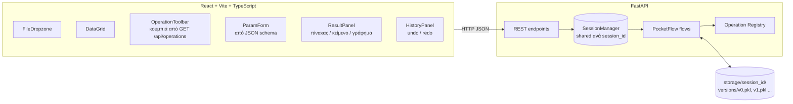
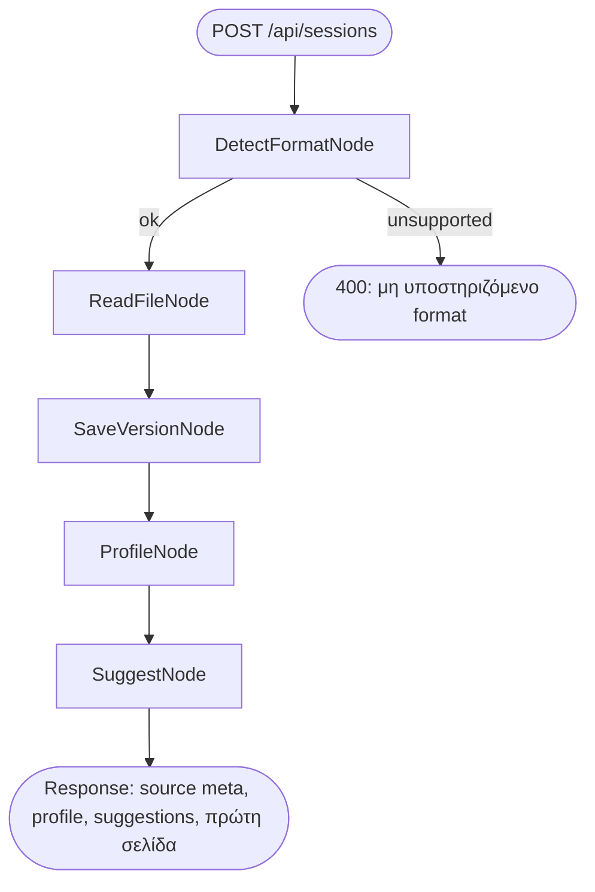
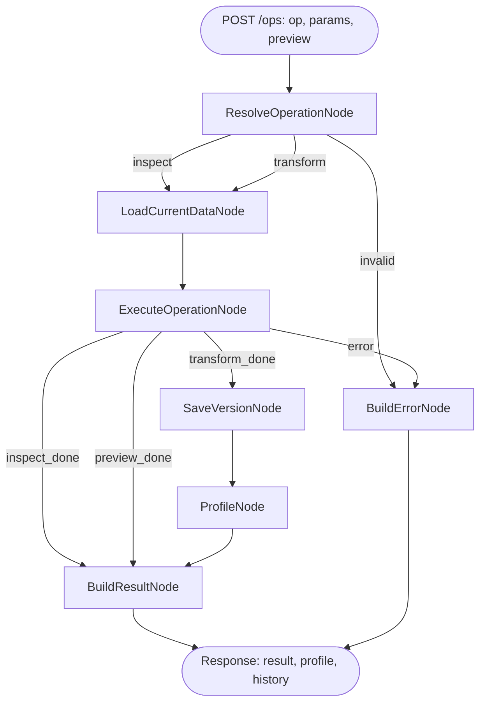
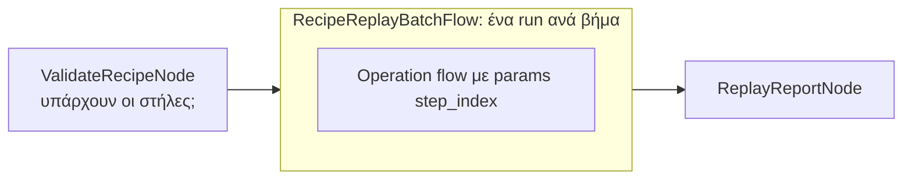
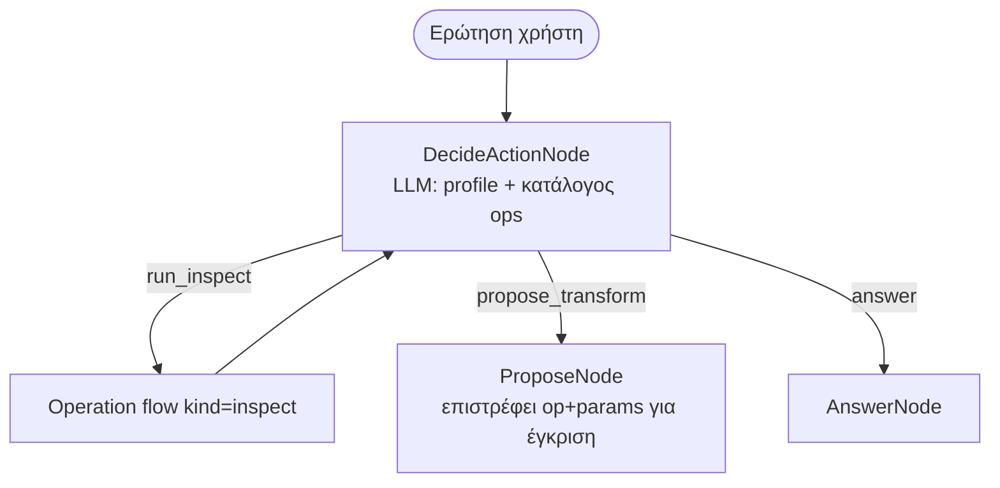
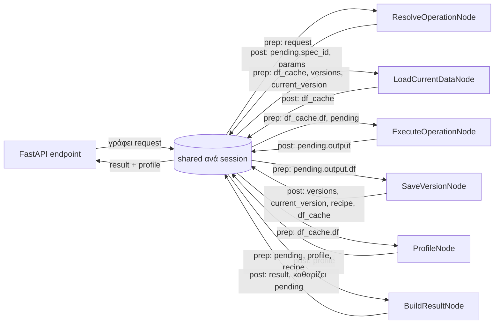

# Design Doc: DataPrep Studio — Button-Driven Data Workbench (React + FastAPI + Pandas)

> Please DON'T remove notes for AI

> Η προηγούμενη έκδοση (σταθερό ML pipeline 2 flows) φυλάχτηκε στο `docs/design_v1_ml_pipeline.md`.
> Σε αυτή την έκδοση γίνεται **ένα από τα πολλά κουμπιά** (macro "ML Prep") και ξαναχρησιμοποιεί τα υπάρχοντα utilities.

### Κατάσταση υλοποίησης (MVP, 2026-11-06)

- **MVP — έτοιμο**: Upload, Operation, Undo/Redo/Checkout, Export, Script flows · τα 26 κουμπιά ★ · React UI · 11 end-to-end tests
  (`tests/test_api.py`, μεταξύ αυτών ότι το `pipeline.py` ξαναχτίζει ακριβώς τον ίδιο πίνακα).
- **Αποφάσεις που άλλαξαν στην υλοποίηση**:
  - Εκδόσεις σε **pickle** (`v{n}.pkl`), όχι parquet: το parquet απορρίπτει στήλες με μικτούς τύπους.
  - Χωρίς `redo_stack`: το ιστορικό είναι γραμμικό, redo = `current_version + 1`. Νέο transform μετά από undo σβήνει τις επόμενες εκδόσεις.
  - `SuggestNode` είναι Regular (μόνο heuristic). Γίνεται Async όταν μπει LLM (phase 3).
  - Excel με πολλά sheets: διαβάζεται το πρώτο· άλλο sheet από «Ξαναδιάβασε» (όχι ξεχωριστό `needs_sheet` branch).
  - Encoding: πριν το charset-normalizer γίνεται έλεγχος cp1253 / iso8859-7 (το charset-normalizer μπερδεύει σύντομα ελληνικά με cp1251).
  - snake_case με Greeklish κατά ELOT 743 (`Ημερομηνία` → `imerominia`).
  - Frontend χωρίς βιβλιοθήκες UI: δικό του form generator από JSON schema, πίνακας και bar charts σε σκέτο React/CSS.
- **Phase 2 (2026-11-06) — έτοιμο**: 86 κουμπιά σε 13 κατηγορίες, charts (histogram, boxplot, bar, scatter, line,
  heatmap — SVG με tooltip και προβολή πίνακα), join με δεύτερο αρχείο (`attachments` στο shared store),
  recipe replay (BatchFlow, rollback σε αποτυχία), ML Prep (v1 pipeline ως 2 κουμπιά, αρχεία στο `storage/<id>/exports/ml`).
  36 tests· δύο από αυτά ελέγχουν ότι το `pipeline.py` ξαναχτίζει ίδιο πίνακα μετά από 38 transforms και μετά από join.
- **Αποφάσεις phase 2**:
  - CSV στήλες με μηδενικά μπροστά (ΑΦΜ, ΤΚ, κωδικοί) διαβάζονται ως κείμενο· το `pipeline.py` κάνει το ίδιο (`dtype=`).
  - Recipe replay: αν ένα βήμα αποτύχει, τα δεδομένα επιστρέφουν στην έκδοση πριν το replay· τα βήματα που πέτυχαν μένουν ως redo.
  - ML Prep: ο v1 advisor έβγαζε «τίτλο» από κάθε στήλη `name` (Titanic)· τώρα μόνο όταν τα ονόματα έχουν μορφή «Επώνυμο, Τίτλος.».
    Κανόνες για στήλες που ο χρήστης βάζει στα `drop_columns` αφαιρούνται αυτόματα.
  - Δεν υλοποιήθηκαν (καλύπτονται από άλλα κουμπιά): `columns.lowercase/strip_special` (→ snake_case), `types.parse_locale_number`
    (→ «→ Αριθμός» με δεκαδικό «,»), `missing.drop_columns` (→ «Διαγραφή με κανόνα»), `datetime.timezone`, `rows.drop_index`.
- **Phase 3a (2026-11-07) — chat βοηθός, έτοιμο**: agent (§6) με actions `run_python` (analyze/transform σε sandbox),
  `run_operation` (όλα τα κουμπιά) και `answer`. Ο κώδικας του μοντέλου είναι κι αυτός registry operation
  (`assistant.python_analyze/transform`, κρυφή κατηγορία), οπότε περνά από το ίδιο Operation flow: εκδόσεις, undo,
  `pipeline.py`, recipe replay. 45 tests (9 για τον βοηθό με fake LLM, χωρίς tokens).
- **Αποφάσεις phase 3a** (αλλάζουν το «όχι αυθαίρετο κώδικα» της αρχικής σχεδίασης, κατόπιν αιτήματος):
  - Sandbox: AST allow-list (μόνο pandas/numpy/sklearn/scipy/statsmodels κ.ά., χωρίς αρχεία/δίκτυο/os/eval/dunder),
    ξεχωριστή `python -I` διεργασία με timeout, κενό environment (χωρίς API keys), σε Linux και όρια μνήμης/CPU.
    Δεν είναι πλήρες security boundary: για δημόσιο server → container χωρίς έξοδο στο δίκτυο.
  - Οι αλλαγές εφαρμόζονται αμέσως (όχι «πρόταση → έγκριση»): κάθε μία είναι νέα έκδοση με αναίρεση.
  - Κόστος: το μοντέλο βλέπει μόνο τις τελευταίες 6 ερωτήσεις/απαντήσεις (όχι τα παλιά tool outputs), έως 6 βήματα ανά
    ερώτηση, prompt caching στο system prompt (Anthropic), όριο μηνυμάτων/ώρα, «Καθαρισμός» μηδενίζει το ιστορικό.
  - Shared store: `shared["chat"] = {messages, usage, turn}`· τα nodes ChatStart → DecideAction ⇄ (ToolRequest →
    Operation flow → ToolResult) → ChatAnswer.
- **Client-side Python (2026-11-07)**: Pyodide σε Web Worker (`frontend/src/pyodide/`). Δεν περνά από PocketFlow ούτε
  από τον server πέρα από ένα `GET /export?format=csv`· οι τύποι στηλών (κείμενο/ημερομηνίες/category) περνούν ως
  hints ώστε το `df` στον browser να έχει τους ίδιους τύπους. «Αποθήκευση ως νέα έκδοση»: `POST /browser-version`
  (CSV + dtypes + κώδικας + base_version) → op `browser.python_version` μέσα από το Operation flow (έκδοση, undo,
  pipeline.py, recipe· στο replay ο κώδικας τρέχει στο sandbox). Έλεγχος base_version → 409 αν ο server άλλαξε.
- **Καρτέλες (2026-11-07)**: `App` = διαχείριση καρτελών, `Workspace` = όλη η οθόνη ενός αρχείου (ήταν το παλιό App).
  Μία καρτέλα = ένα server session (το backend ήδη υποστήριζε πολλά). Όλα τα Workspace μένουν mounted και τα ανενεργά
  κρύβονται με CSS, οπότε κρατούν state χωρίς global store. Κλείσιμο → `DELETE /api/sessions/{id}`.
- **Επαναφορά καρτελών & μνήμη (2026-11-07)**: `utils/session_store.py` γράφει το `shared` (χωρίς DataFrame) σε
  `session.pkl` μετά από κάθε flow· `_session()` το ξαναφορτώνει αν λείπει από τη μνήμη. LRU στο app.py: πίνακες στη RAM
  μόνο για τις N πιο πρόσφατες συνεδρίες (`hydrate` από `versions/` όταν χρειαστεί), ποτέ για συνεδρία με ενεργό lock.
  Startup: διαγράφει μόνο συνεδρίες παλαιότερες του TTL (όχι πια όλες). Frontend: λίστα καρτελών στο localStorage,
  lazy restore όταν η καρτέλα γίνει ενεργή, μήνυμα «έληξε» όταν ο server απαντά 404.
- **Επόμενα**: phase 3b — LLM προτάσεις στο upload (SuggestNode σε Async), αν χρειαστεί.

---

## Requirements

> Notes for AI: Keep it simple and clear.
> If the requirements are abstract, write concrete user stories

### Το πρόβλημα από τη μεριά του χρήστη

Ο χρήστης έχει ένα αρχείο δεδομένων (CSV από ERP, Excel από πελάτη, JSON από API, Parquet από data lake) και θέλει
να το **καταλάβει** και να το **καθαρίσει** χωρίς να γράψει κώδικα. Ανοίγει το site, ανεβάζει το αρχείο, βλέπει
τον πίνακα και πατάει κουμπιά: κάθε κουμπί τρέχει μια συγκεκριμένη λειτουργία pandas (`info()`, `describe()`,
snake_case στήλες, γέμισμα κενών κ.λπ.). Βλέπει αμέσως το αποτέλεσμα, μπορεί να κάνει **undo**, και στο τέλος
κατεβάζει το καθαρό αρχείο **και** ένα script Python που αναπαράγει ακριβώς τα βήματα.

### User stories

1. **Upload οποιουδήποτε αρχείου** — Ως χρήστης ανεβάζω CSV / TSV / TXT / Excel (xlsx, xls, ods) / JSON / JSONL /
   Parquet / Feather / XML. Το σύστημα αναγνωρίζει μόνο του format, **character encoding** (utf-8, cp1253, iso-8859-7,
   latin-1…), διαχωριστικό (`,` `;` `\t` `|`) και δεκαδικό σύμβολο (`.` ή `,`). Αν το Excel έχει πολλά sheets, διαλέγω ποιο.
2. **Άμεση εικόνα** — Μετά το upload βλέπω πίνακα με σελιδοποίηση, shape, dtypes, % κενών ανά στήλη και ένα
   "Data Quality Score".
3. **Κουμπιά επιθεώρησης (read-only)** — `info()`, `describe()`, missing report, value counts, duplicates,
   correlation, outliers, memory usage. Δεν αλλάζουν τα δεδομένα.
4. **Κουμπιά μετασχηματισμού** — π.χ. "Ονόματα στηλών → snake_case", "Έξυπνο γέμισμα κενών ανά τύπο στήλης",
   "One-hot encoding". Κάθε πάτημα δημιουργεί **νέα έκδοση** του dataset.
5. **Παράμετροι** — Αν ένα κουμπί χρειάζεται επιλογές (ποιες στήλες, στρατηγική, threshold), ανοίγει μικρή φόρμα
   που δημιουργείται αυτόματα από το schema της λειτουργίας.
6. **Undo / Redo / Ιστορικό** — Βλέπω τη λίστα βημάτων (recipe), επιστρέφω σε οποιαδήποτε έκδοση.
7. **Preview πριν την εφαρμογή** — Για βαριές αλλαγές βλέπω "πριν / μετά" σε δείγμα πριν πατήσω "Εφαρμογή".
8. **Γραφήματα** — Histogram, boxplot, bar chart κατηγοριών, scatter, heatmap συσχετίσεων.
9. **Export** — Κατεβάζω το αποτέλεσμα σε CSV (με επιλογή encoding, π.χ. `utf-8-sig` για σωστά ελληνικά στο Excel),
   Excel, JSON, Parquet· επίσης `recipe.json` και `pipeline.py`.
10. **Replay recipe** — Ανεβάζω νέο αρχείο ίδιας μορφής (π.χ. το export του επόμενου μήνα) και εφαρμόζω το
    αποθηκευμένο recipe με ένα κλικ.
11. **(Phase 2) AI βοηθός** — Γράφω "γέμισε τα κενά και φτιάξε τις ημερομηνίες" και ο βοηθός προτείνει
    λειτουργίες **από τον κατάλογο** (όχι αυθαίρετο κώδικα), τις οποίες εγκρίνω.

### Εκτός scope (για αρχή)

- Λογαριασμοί χρηστών / multi-tenant auth (μόνο ανώνυμα sessions).
- Αυθαίρετη εκτέλεση Python από τον χρήστη ή το LLM (κίνδυνος ασφαλείας).
- Αρχεία > 200 MB (ρυθμιζόμενο όριο).

### Γιατί ταιριάζει (και πού όχι) το AI

Ο πυρήνας είναι **ντετερμινιστικός** (pandas). Το LLM είναι προαιρετικό, χρήσιμο μόνο για *προτάσεις* και για τον
βοηθό φυσικής γλώσσας. Στο LLM στέλνεται **μόνο το profile** (ονόματα στηλών, τύποι, στατιστικά), **ποτέ γραμμές
δεδομένων** — τα αρχεία πελατών είναι εμπιστευτικά. Default: `advisor_mode = "heuristic"` (χωρίς δίκτυο).

---

## System Architecture



### Βασική ιδέα: Operation Registry

Κάθε κουμπί αντιστοιχεί σε **μία εγγραφή** στο registry:

| Πεδίο | Περιγραφή |
|---|---|
| `id` | π.χ. `columns.snake_case` |
| `label` / `description` | Κείμενο κουμπιού και tooltip (ελληνικά) |
| `category` | `inspect`, `columns`, `types`, `missing`, `duplicates`, `text`, `datetime`, `numeric`, `categorical`, `rows`, `reshape`, `charts`, `ml` |
| `kind` | `inspect` (δεν αλλάζει δεδομένα) ή `transform` (νέα έκδοση) |
| `params_model` | Pydantic model → JSON schema → φόρμα στο React |
| `fn` | Καθαρή συνάρτηση `fn(df, params) -> OpOutput` |
| `code_template` | Το ισοδύναμο pandas snippet για το `pipeline.py` |

Το React **δεν έχει hard-coded κουμπιά**: τα φορτώνει από το `GET /api/operations`. Νέα λειτουργία = νέα συνάρτηση
+ μία εγγραφή στο registry → εμφανίζεται αυτόματα κουμπί.

### REST endpoints

| Method | Path | Flow / Ενέργεια |
|---|---|---|
| `POST` | `/api/sessions` (multipart file) | Upload flow |
| `POST` | `/api/sessions/{id}/reload` | Upload flow με override `encoding` / `delimiter` / `sheet` |
| `GET` | `/api/operations` | Κατάλογος κουμπιών + JSON schemas |
| `GET` | `/api/sessions/{id}/data?page=&size=&sort=` | Σελίδα από την τρέχουσα έκδοση |
| `GET` | `/api/sessions/{id}/profile` | Profile τρέχουσας έκδοσης |
| `POST` | `/api/sessions/{id}/ops` `{op, params, preview}` | Operation flow |
| `POST` | `/api/sessions/{id}/undo` · `/redo` · `/checkout/{version}` | Αλλαγή δείκτη έκδοσης |
| `GET` | `/api/sessions/{id}/history` | Recipe + λίστα εκδόσεων |
| `GET` | `/api/sessions/{id}/export?format=csv&encoding=utf-8-sig` | Export flow |
| `GET` | `/api/sessions/{id}/script` | `pipeline.py` |
| `POST` | `/api/sessions/{id}/recipe/apply` (recipe.json) | Recipe replay flow |
| `POST` | `/api/sessions/{id}/assistant` `{question}` | Assistant flow (phase 2) |

---

## Flow Design

> Notes for AI:
> 1. Consider the design patterns of agent, map-reduce, rag, and workflow. Apply them if they fit.
> 2. Present a concise, high-level description of the workflow.

### Applicable Design Pattern

1. **Workflow** — Upload flow, Operation flow, Export flow: σύντομες αλυσίδες κόμβων με branching μέσω actions.
2. **Command pattern + Registry** — κάθε κουμπί είναι command (`op` + `params`) που εκτελεί **ο ίδιος** generic
   Operation flow. Δεν φτιάχνουμε ένα flow ανά κουμπί.
3. **Batch (BatchFlow)** — Recipe replay: το Operation flow ξανατρέχει μία φορά ανά βήμα του recipe, **σειριακά**
   (κάθε βήμα εξαρτάται από το προηγούμενο), με `params = {"step_index": i}`.
4. **Agent (phase 2)** — Assistant flow:
   - *Context*: ερώτηση χρήστη, profile τρέχουσας έκδοσης, κατάλογος λειτουργιών (id + περιγραφή + schema), αποτελέσματα προηγούμενων inspect.
   - *Actions*: `run_inspect` (εκτελείται αμέσως), `propose_transform` (περιμένει έγκριση χρήστη), `answer`.
5. **Δεν ταιριάζουν**: RAG (δεν υπάρχει corpus), Map-Reduce/Parallel (pandas σε ένα frame είναι ήδη vectorized· τα βήματα είναι εξαρτημένα).

### Flow high-level Design

#### 1. Upload flow (`POST /api/sessions`)

1. **DetectFormatNode** — Από extension + magic bytes βρίσκει format, character encoding, delimiter, decimal, sheets.
2. **ReadFileNode** — Διαβάζει το αρχείο σε DataFrame με τις ρυθμίσεις του 1 (ή τα overrides του χρήστη). Κανονικοποιεί placeholders κενών (`""`, `"N/A"`, `"-"`, `"?"`, `"null"`) σε NaN μόνο αν το ζητήσει ο χρήστης (default off, αναφέρονται ως warning).
3. **SaveVersionNode** — Αποθηκεύει ως `v0.pkl`, ορίζει `current_version = 0`.
4. **ProfileNode** — Υπολογίζει profile + quality score της τρέχουσας έκδοσης.
5. **SuggestNode** — Προτείνει κουμπιά για αυτό το dataset (heuristic ή LLM), π.χ. "3 στήλες με κενά → Έξυπνο γέμισμα", "ονόματα με κενά/κεφαλαία → snake_case".



#### 2. Operation flow (`POST /api/sessions/{id}/ops`) — τρέχει σε κάθε πάτημα κουμπιού

1. **ResolveOperationNode** — Βρίσκει το `op` στο registry και επικυρώνει τα `params` με το Pydantic model. Action: `inspect` / `transform` / `invalid`.
2. **LoadCurrentDataNode** — Φέρνει το DataFrame της τρέχουσας έκδοσης (από cache ή από τον δίσκο).
3. **ExecuteOperationNode** — Τρέχει `op.fn(df, params)` (με `max_retries=1`· οι λειτουργίες είναι ντετερμινιστικές). Action: `inspect_done` / `transform_done` / `preview_done`.
4. **SaveVersionNode** — (μόνο transform) γράφει `v{n+1}.pkl`, προσθέτει βήμα στο recipe, σβήνει τις εκδόσεις μετά το `current_version`.
5. **ProfileNode** — (μόνο transform) ξαναϋπολογίζει profile.
6. **BuildResultNode** — Μετατρέπει το αποτέλεσμα σε JSON-safe `result` για το React (πίνακας / κείμενο / chart spec / diff πριν-μετά), μαζί με το pandas snippet.



> Το `ExecuteOperationNode` χρησιμοποιεί `exec_fallback` ώστε ένα σφάλμα pandas (π.χ. λάθος format ημερομηνίας)
> να γίνει φιλικό μήνυμα με action `error`, αντί για 500. Τα utilities **δεν** έχουν try/except.

#### 3. Undo / Redo / Checkout

Δεν χρειάζεται flow: μετακινεί μόνο τον δείκτη `current_version`, και μετά τρέχει μόνο
**ProfileNode → BuildResultNode** (μικρό flow `create_refresh_flow()`).

#### 4. Export flow (`GET /export`, `GET /script`)

1. **LoadCurrentDataNode**
2. **WriteExportNode** — γράφει στο format/encoding που ζητήθηκε.
3. **GenerateScriptNode** — ενώνει τα `code` των βημάτων του recipe σε `pipeline.py` με σωστό `read_*` (ίδιο encoding/delimiter με το αρχικό αρχείο).

#### 5. Recipe replay flow (`POST /recipe/apply`) — BatchFlow



`ValidateRecipeNode` ελέγχει εκ των προτέρων ότι οι στήλες που χρειάζεται κάθε βήμα υπάρχουν (λαμβάνοντας υπόψη
τις μετονομασίες των προηγούμενων βημάτων) και επιστρέφει λίστα ασυμφωνιών **πριν** αλλάξει οτιδήποτε.

#### 6. Assistant flow (phase 2) — Agent



Όριο `max_steps = 5`. Το LLM μπορεί να επιλέξει **μόνο** `op` που υπάρχουν στο registry· τα `params` περνούν
από το ίδιο Pydantic validation. Τα transforms εκτελούνται μόνο όταν ο χρήστης πατήσει "Εφαρμογή".

---

## Κατάλογος λειτουργιών (κουμπιά)

> Notes for AI: Κάθε γραμμή = μία εγγραφή registry. Ξεκίνα με τις λειτουργίες ★ (MVP), μετά τις υπόλοιπες.

### Inspect (read-only)

| id | Κουμπί | Τι τρέχει | Αποτέλεσμα |
|---|---|---|---|
| ★ `inspect.info` | Info | `df.info()` σε buffer + δομημένος πίνακας (στήλη, dtype, non-null, null %) | πίνακας + κείμενο |
| ★ `inspect.describe` | Describe | `df.describe(include=...)` με επιλογή numeric / categorical / datetime / all, + skew, kurtosis | πίνακας |
| ★ `inspect.head_tail_sample` | Head / Tail / Sample | `head(n)`, `tail(n)`, `sample(n, random_state)` | πίνακας |
| ★ `inspect.missing` | Ανάλυση κενών | count, % ανά στήλη, γραμμές με ≥1 κενό, μοτίβα κενών | πίνακας + bar chart |
| ★ `inspect.value_counts` | Συχνότητες τιμών | `value_counts(dropna=False, normalize)` για στήλη | πίνακας + bar chart |
| ★ `inspect.duplicates` | Διπλότυπα | πλήρη / σε subset στηλών, παράδειγμα γραμμών | πίνακας |
| `inspect.unique` | Μοναδικές τιμές | `nunique`, cardinality ratio, σταθερές στήλες | πίνακας |
| `inspect.dtypes_check` | Έλεγχος τύπων | mixed types, αριθμοί/ημερομηνίες κρυμμένοι σε text | πίνακας με προτάσεις |
| `inspect.correlation` | Συσχετίσεις | `corr(method=pearson/spearman/kendall)`, top ζεύγη | heatmap |
| `inspect.outliers` | Outliers | IQR και z-score ανά αριθμητική στήλη | πίνακας + boxplot |
| `inspect.memory` | Μνήμη | `memory_usage(deep=True)` + πρόταση downcast | πίνακας |
| `inspect.quality_score` | Data Quality Score | completeness, uniqueness, validity, consistency (0–100) | κάρτες |
| `inspect.column_profile` | Προφίλ στήλης | όλα τα στατιστικά + histogram για μία στήλη | κάρτα + chart |
| `inspect.groupby` | Group-by σύνοψη | `groupby(cols).agg(...)` (preview, δεν αλλάζει dataset) | πίνακας |
| `inspect.crosstab` | Crosstab | `pd.crosstab(a, b, normalize)` | πίνακας / heatmap |
| `inspect.file_encoding` | Encoding αρχείου | εντοπισμένο encoding, confidence, εναλλακτικές, delimiter | κάρτα + κουμπί "Ξαναδιάβασε με…" |

### Columns (ονόματα & δομή)

| id | Κουμπί | Τι κάνει |
|---|---|---|
| ★ `columns.snake_case` | snake_case ονόματα | `"Customer ID " → customer_id`, `"ΌνομαΠελάτη" → onoma_pelati` (προαιρετικό transliteration), μοναδικά ονόματα (`_2`, `_3`) |
| ★ `columns.rename` | Μετονομασία | χάρτης `old → new` από φόρμα |
| ★ `columns.drop` | Διαγραφή στηλών | επιλογή στηλών |
| `columns.drop_by_rule` | Διαγραφή με κανόνα | στήλες με > X% κενά, σταθερές, ID-like (unique ≈ rows) |
| `columns.lowercase` / `uppercase` | Μικρά / κεφαλαία ονόματα | |
| `columns.strip_special` | Καθάρισμα ονομάτων | αφαίρεση ειδικών χαρακτήρων, διπλών κενών |
| `columns.reorder` | Αναδιάταξη | drag & drop σειρά |
| `columns.prefix_suffix` | Prefix / suffix | σε επιλεγμένες στήλες |
| `columns.promote_header` | Γραμμή → header | όταν το αρχείο έχει τίτλο πάνω από τον πίνακα |
| `columns.duplicate` | Αντίγραφο στήλης | |

### Types

| id | Κουμπί | Τι κάνει |
|---|---|---|
| ★ `types.auto_infer` | Αυτόματοι τύποι | `convert_dtypes()` + ανίχνευση αριθμών/ημερομηνιών σε text |
| ★ `types.to_numeric` | → Αριθμός | `pd.to_numeric(errors="coerce")`, με αναφορά πόσες τιμές έγιναν NaN |
| ★ `types.to_datetime` | → Ημερομηνία | `pd.to_datetime(format=…, dayfirst=True)` |
| `types.to_category` | → Category | για χαμηλό cardinality, εξοικονόμηση μνήμης |
| `types.to_bool` | → Boolean | χάρτης `yes/no, ναι/όχι, 1/0, true/false` |
| `types.parse_locale_number` | Ευρωπαϊκοί αριθμοί | `"1.234,56 €"` → `1234.56`, `"15%"` → `0.15` |
| `types.downcast` | Μείωση μνήμης | `int64 → int32/int8`, `float64 → float32` όπου ασφαλές |

### Missing values

| id | Κουμπί | Τι κάνει |
|---|---|---|
| ★ `missing.standardize` | Ενοποίηση κενών | `""`, `" "`, `N/A`, `NA`, `-`, `?`, `null`, `None`, `nan` → `NaN` |
| ★ `missing.smart_fill` | **Έξυπνο γέμισμα ανά τύπο στήλης** | numeric: median (ή mean αν |skew| < 0.5) · categorical/text: mode ή `"Unknown"` · boolean: mode · datetime: ffill ή median date · στήλες > X% κενά: παραλείπονται με warning. Επιστρέφει πίνακα "στήλη → στρατηγική → τιμή" |
| ★ `missing.fill_value` | Γέμισμα με τιμή | σταθερά ανά στήλη |
| ★ `missing.drop_rows` | Διαγραφή γραμμών με κενά | `how=any/all`, `thresh`, `subset` |
| `missing.drop_columns` | Διαγραφή στηλών με κενά | πάνω από threshold % |
| `missing.ffill_bfill` | Forward / Backward fill | με προαιρετικό `groupby` και `limit` |
| `missing.interpolate` | Interpolation | linear / time (για χρονοσειρές) |
| `missing.group_fill` | Γέμισμα ανά ομάδα | median/mode ανά `groupby` (π.χ. ηλικία ανά φύλο & κλάση) |
| `missing.knn_impute` | KNN impute | `sklearn.impute.KNNImputer` για αριθμητικές |
| `missing.indicator` | Στήλες-δείκτες κενών | `col_was_missing` (0/1) πριν το γέμισμα |

### Duplicates

| id | Κουμπί | Τι κάνει |
|---|---|---|
| ★ `duplicates.drop` | Διαγραφή διπλότυπων | `drop_duplicates(subset, keep)` |
| `duplicates.flag` | Σήμανση διπλότυπων | νέα στήλη `is_duplicate` |
| `duplicates.fuzzy_report` | Παρόμοια κείμενα | "Αθήνα" vs "ΑΘΗΝΑ " vs "Athina" (rapidfuzz) — μόνο αναφορά |

### Text

| id | Κουμπί | Τι κάνει |
|---|---|---|
| ★ `text.strip` | Trim κενών | `str.strip()` + συμπίεση πολλαπλών κενών |
| ★ `text.case` | Πεζά / Κεφαλαία / Title | |
| `text.remove_accents` | Αφαίρεση τόνων | `"Αθήνα" → "Αθηνα"` (unicodedata) |
| `text.transliterate` | Greeklish | `"Αθήνα" → "Athina"` (unidecode) |
| `text.fix_mojibake` | Διόρθωση "σπασμένων" χαρακτήρων | `"Αθήνα" → "Αθήνα"` (ftfy) |
| `text.replace` | Αντικατάσταση | απλό ή regex |
| `text.extract` | Εξαγωγή με regex | π.χ. τίτλος από όνομα, ΤΚ από διεύθυνση |
| `text.split` | Διαχωρισμός στήλης | `"Παπαδόπουλος, Γιάννης"` → 2 στήλες |
| `text.concat` | Ένωση στηλών | με separator |
| `text.length` | Μήκος κειμένου | νέα στήλη |
| `text.validate_pattern` | Έλεγχος μορφής | email, τηλέφωνο, ΑΦΜ, IBAN → στήλη `is_valid` |

### Datetime

| id | Κουμπί | Τι κάνει |
|---|---|---|
| ★ `datetime.extract_parts` | Ανάλυση ημερομηνίας | year, month, day, weekday, quarter, hour, is_weekend |
| `datetime.diff` | Διαφορά ημερομηνιών | σε ημέρες/μήνες μεταξύ δύο στηλών ή από σήμερα |
| `datetime.timezone` | Ζώνη ώρας | `tz_localize` / `tz_convert` |
| `datetime.floor` | Στρογγυλοποίηση | σε ημέρα / εβδομάδα / μήνα |

### Numeric

| id | Κουμπί | Τι κάνει |
|---|---|---|
| ★ `numeric.outliers_clip` | Outliers → clip | IQR (factor) ή percentiles (1%–99%) |
| `numeric.outliers_remove` | Outliers → διαγραφή γραμμών | IQR ή z-score |
| `numeric.round` | Στρογγυλοποίηση | |
| `numeric.transform` | Log / sqrt / Box-Cox | `log1p` για skewed στήλες |
| `numeric.binning` | Κατηγοριοποίηση | `pd.cut` (ίσα διαστήματα / custom όρια) ή `pd.qcut` (quantiles) |
| `numeric.scale` | Κλιμάκωση | Standard / MinMax / Robust |
| `numeric.formula` | Νέα στήλη από πράξη | **δομημένη** φόρμα: `col_a [+ − × ÷] col_b / σταθερά` (όχι `eval`) |

### Categorical (encoding κατηγοριών)

| id | Κουμπί | Τι κάνει |
|---|---|---|
| ★ `categorical.one_hot` | One-hot | `pd.get_dummies(drop_first=…)` |
| ★ `categorical.label` | Label encoding | κατηγορία → ακέραιος, ο χάρτης φαίνεται στο αποτέλεσμα |
| `categorical.ordinal` | Ordinal | ο χρήστης ορίζει σειρά (low < medium < high) |
| `categorical.binary_map` | Binary map | δύο τιμές → 0/1 |
| `categorical.frequency` | Frequency encoding | κατηγορία → συχνότητα |
| `categorical.rare_group` | Σπάνιες → "Other" | κατηγορίες κάτω από X% |
| `categorical.standardize_labels` | Ενοποίηση ετικετών | trim + case + χάρτης συνωνύμων |

> Σημείωση: "encoding" έχει δύο έννοιες στο UI και τις κρατάμε ξεχωριστές:
> **character encoding αρχείου** (utf-8, cp1253…) → `inspect.file_encoding`, reload, export · **encoding κατηγοριών** → κατηγορία `categorical`.

### Rows

| id | Κουμπί | Τι κάνει |
|---|---|---|
| ★ `rows.filter` | Φίλτρο | δομημένες συνθήκες `[στήλη][==, !=, >, <, contains, isin, isna, between][τιμή]` με AND/OR |
| ★ `rows.sort` | Ταξινόμηση | πολλαπλές στήλες, asc/desc |
| `rows.sample` | Δείγμα | n ή %, stratified |
| `rows.drop_index` | Διαγραφή επιλεγμένων γραμμών | από επιλογή στο grid |
| `rows.top_n` | Top / Bottom N | `nlargest` / `nsmallest` |

### Reshape

| id | Κουμπί | Τι κάνει |
|---|---|---|
| `reshape.groupby_agg` | Συνάθροιση | `groupby().agg()` → αντικαθιστά το dataset (νέα έκδοση) |
| `reshape.pivot` | Pivot | `pivot_table(index, columns, values, aggfunc)` |
| `reshape.melt` | Unpivot | `melt(id_vars, value_vars)` |
| `reshape.transpose` | Transpose | |
| `reshape.merge` | Join με 2ο αρχείο | ανέβασμα δεύτερου αρχείου, `merge(how, on)` (phase 2) |

### Charts (read-only, ο backend στέλνει δεδομένα, όχι εικόνες)

`charts.histogram`, `charts.boxplot`, `charts.bar`, `charts.scatter` (δείγμα έως 5.000 σημεία), `charts.line` (χρονοσειρά),
`charts.heatmap` (correlation / missing pattern).

### ML Prep (macro — ξαναχρησιμοποιεί το v1 pipeline)

| id | Κουμπί | Τι κάνει |
|---|---|---|
| `ml.suggest_config` | Πρόταση κανόνων ML | `schema_advisor.suggest_cleaning_config` |
| `ml.leakage_free_prep` | Train/Test prep χωρίς leakage | split → impute/outliers fit στο train → encode/scale → `train_clean.csv` + `test_clean.csv` (τα 4 nodes του v1 ως sub-flow) |

---

## Utility Functions

> Notes for AI:
> 1. Understand the utility function definition thoroughly by reviewing the doc.
> 2. Include only the necessary utility functions, based on nodes in the flow.
> 3. Κανένα try/except μέσα στα utilities· τα σφάλματα τα πιάνει το retry/fallback του Node.
> 4. Κάθε αρχείο έχει `if __name__ == "__main__":` με μικρό τεστ σε συνθετικό DataFrame.

### Υποδομή

1. **Detect file** (`utils/file_detect.py`)
   - `detect_format(path, filename) -> str` — extension + magic bytes (`PK` = xlsx/ods, `PAR1` = parquet).
   - `detect_encoding(path, sample_bytes=200_000) -> {"encoding", "confidence", "alternatives"}` — `charset-normalizer`· BOM check πρώτα· ειδική λογική για ελληνικά (cp1253 vs iso-8859-7).
   - `sniff_csv(path, encoding) -> {"delimiter", "decimal", "thousands", "has_header", "skiprows"}` — `csv.Sniffer` + μέτρηση delimiters.
   - `list_sheets(path) -> list[str]`
   - *Χρήση*: DetectFormatNode.
2. **Read any file** (`utils/file_reader.py`)
   - `read_any(path, fmt, options) -> (df, warnings)` — dispatcher σε `read_csv / read_excel / read_json / read_parquet / read_feather / read_xml`. Για JSON nested: `pd.json_normalize`.
   - *Χρήση*: ReadFileNode, Recipe replay.
3. **Write file** (`utils/file_writer.py`)
   - `write_any(df, fmt, path, encoding="utf-8-sig", **opts) -> path`
   - *Χρήση*: WriteExportNode.
4. **Version store** (`utils/version_store.py`)
   - `save_version(session_dir, n, df) -> path` (pickle, διατηρεί dtypes και μικτούς τύπους) · `load_version(path) -> df` · `delete_versions(paths)`
   - *Χρήση*: SaveVersionNode, LoadCurrentDataNode.
5. **Profile** (`utils/pandas_profiler.py` — **υπάρχει**, επέκταση)
   - `profile_dataframe(df) -> dict` + νέο `quality_score(profile) -> dict`.
   - *Χρήση*: ProfileNode, inspect ops.
6. **JSON-safe** (`utils/json_safe.py`)
   - `to_jsonable(obj)` — NaN/NaT → `None`, numpy → Python, Timestamp → ISO string· `df_page(df, page, size) -> {"columns", "rows", "total"}`.
   - *Χρήση*: BuildResultNode, `/data` endpoint.
7. **Operation registry** (`utils/op_registry.py`)
   - `OperationSpec` dataclass (`id, label, description, category, kind, params_model, fn, code_template`)
   - `register(spec)`, `get_op(op_id) -> OperationSpec`, `catalog() -> list[dict]` (με `params_model.model_json_schema()`)
   - `OpOutput` dataclass: `df` (μόνο transform), `result` (πίνακας/κείμενο/chart spec), `message`, `warnings`.
   - *Χρήση*: ResolveOperationNode, ExecuteOperationNode, `/operations`.
8. **Code generation** (`utils/code_gen.py`)
   - `render_step(spec, params) -> str` · `build_script(source_meta, recipe) -> str`
   - *Χρήση*: SaveVersionNode (κρατά snippet ανά βήμα), GenerateScriptNode.
9. **Diff** (`utils/diff.py`)
   - `diff_summary(before, after) -> dict` — αλλαγή shape, νέες/διαγραμμένες/μετονομασμένες στήλες, αλλαγές dtype, κελιά που άλλαξαν (σε δείγμα).
   - *Χρήση*: BuildResultNode (preview & μετά από transform).
10. **Call LLM** (`utils/call_llm.py` — **υπάρχει**)
    - *Χρήση*: SuggestNode (mode `llm`), DecideActionNode. Μόνο profile στο prompt, ποτέ γραμμές.

### Λειτουργίες (μία συνάρτηση ανά κουμπί, υπογραφή `fn(df, params) -> OpOutput`)

| Αρχείο | Περιεχόμενο | Ξαναχρησιμοποιεί |
|---|---|---|
| `utils/ops/inspect.py` | info, describe, head/tail/sample, missing, value_counts, duplicates, unique, dtypes_check, correlation, outliers, memory, quality, column_profile, groupby, crosstab | `pandas_profiler` |
| `utils/ops/columns.py` | snake_case, rename, drop, drop_by_rule, case, strip_special, reorder, prefix_suffix, promote_header | `structural_ops.to_snake` |
| `utils/ops/types.py` | auto_infer, to_numeric, to_datetime, to_category, to_bool, parse_locale_number, downcast | `structural_ops._cast_types` |
| `utils/ops/missing.py` | standardize, smart_fill, fill_value, drop_rows, drop_columns, ffill_bfill, interpolate, group_fill, knn, indicator | λογική από `stat_transformers` |
| `utils/ops/duplicates.py` | drop, flag, fuzzy_report | |
| `utils/ops/text.py` | strip, case, remove_accents, transliterate, fix_mojibake, replace, extract, split, concat, length, validate_pattern | |
| `utils/ops/datetime_ops.py` | extract_parts, diff, timezone, floor | |
| `utils/ops/numeric.py` | outliers_clip/remove, round, transform, binning, scale, formula | `stat_transformers`, `encode_scale_ops` |
| `utils/ops/categorical.py` | one_hot, label, ordinal, binary_map, frequency, rare_group, standardize_labels | `encode_scale_ops` |
| `utils/ops/rows.py` | filter, sort, sample, drop_index, top_n | |
| `utils/ops/reshape.py` | groupby_agg, pivot, melt, transpose, merge | |
| `utils/ops/charts.py` | histogram, boxplot, bar, scatter, line, heatmap → chart spec JSON | |
| `utils/ops/ml_prep.py` | suggest_config, leakage_free_prep | `schema_advisor`, `structural_ops`, `stat_transformers`, `encode_scale_ops`, `artifact_exporter` |

Παράδειγμα (μόνο για καθαρότητα του contract):

- `name`: `smart_fill` (`utils/ops/missing.py`)
- `input`: `df`, `params = {columns: list[str] | "all", numeric_strategy: "auto"|"median"|"mean", categorical_strategy: "mode"|"constant", constant: "Unknown", skip_if_missing_pct_over: 60}`
- `output`: `OpOutput(df=filled_df, result={"table": [{"column", "dtype", "strategy", "fill_value", "filled_count"}]}, warnings=[...])`
- `necessity`: Το πιο συχνό κουμπί καθαρισμού· "γέμισμα με τιμές ανάλογα τις στήλες".

### Βιβλιοθήκες

| Backend | Γιατί |
|---|---|
| `fastapi`, `uvicorn`, `python-multipart` | API + upload |
| `pydantic` v2 | params validation + JSON schema για φόρμες |
| `pandas`, `numpy` | πυρήνας |
| `pyarrow` | parquet/feather, γρήγορη αποθήκευση εκδόσεων |
| `openpyxl`, `xlrd`, `odfpy` | xlsx, xls, ods |
| `lxml` | `read_xml` |
| `charset-normalizer` | ανίχνευση encoding |
| `ftfy`, `unidecode` | mojibake, greeklish |
| `rapidfuzz` | fuzzy duplicates |
| `scikit-learn`, `scipy` | KNN impute, scalers, Box-Cox, z-score |
| `pocketflow` | flows |

| Frontend | Γιατί |
|---|---|
| React + Vite + TypeScript | βάση |
| *(MVP: όλα τα παρακάτω υλοποιήθηκαν με σκέτο React/CSS· οι βιβλιοθήκες μπαίνουν όταν χρειαστούν)* | |
| TanStack Query | κλήσεις API, cache, loading states |
| TanStack Table (ή AG Grid Community) | grid με server-side pagination |
| `@rjsf/core` (react-jsonschema-form) | αυτόματες φόρμες params από JSON schema |
| Recharts ή Plotly.js | γραφήματα από chart spec (phase 2: charts) |
| `react-dropzone` | upload |
| Tailwind CSS + shadcn/ui | UI |
| Zustand | τοπικό state (session_id, επιλεγμένη στήλη) |

---

## Node Design

### Shared Store

> Notes for AI: Try to minimize data redundancy

Ένα `shared` dict **ανά session**, που το κρατάει ο `SessionManager` του FastAPI στη μνήμη. Τα δεδομένα ζουν σε
pickle στον δίσκο· στη μνήμη κρατάμε **μόνο** το DataFrame της τρέχουσας έκδοσης (`df_cache`). Οι εκδόσεις είναι
λίστα από μικρά metadata dicts με path, όχι αντίγραφα DataFrame.

```python
shared = {
    # --- Session (γράφει ο SessionManager, μόνο μία φορά) ---
    "session": {
        "id": "7b917e24-...",
        "storage_dir": "storage/7b917e24-...",
        "created_at": "2026-11-06T10:15:00",
        "advisor_mode": "heuristic",          # "heuristic" | "llm"
    },

    # --- Αρχικό αρχείο (γράφουν DetectFormatNode / ReadFileNode) ---
    "source": {
        "filename": "pelates_2026.csv",
        "path": "storage/7b917e24-.../source.csv",
        "size_bytes": 1832211,
        "format": "csv",                      # csv|tsv|excel|ods|json|jsonl|parquet|feather|xml
        "encoding": "cp1253",
        "encoding_confidence": 0.93,
        "encoding_alternatives": ["iso-8859-7", "utf-8"],
        "delimiter": ";",
        "decimal": ",",
        "sheet": None,
        "sheets": [],                         # για Excel με πολλά sheets
        "read_overrides": {},                 # ό,τι άλλαξε ο χρήστης στο "Ξαναδιάβασε με..."
        "read_warnings": ["12 γραμμές με λάθος αριθμό πεδίων παραλείφθηκαν"],
    },

    # --- Εκδόσεις (γράφει SaveVersionNode, undo/redo μετακινούν δείκτη) ---
    "versions": [
        {"version": 0, "path": ".../versions/v0.pkl", "shape": [5000, 14], "step": None},
        {"version": 1, "path": ".../versions/v1.pkl", "shape": [5000, 14], "step": 1},
    ],
    "current_version": 1,                     # undo = -1, redo = +1 (γραμμικό ιστορικό)

    # --- Cache της τρέχουσας έκδοσης (μόνο αυτό το DataFrame είναι στη μνήμη) ---
    "df_cache": {"version": 1, "df": "<pd.DataFrame>"},

    # --- Profile τρέχουσας έκδοσης (γράφει ProfileNode) ---
    "profile": {
        "version": 1,
        "shape": [5000, 14],
        "memory_mb": 3.4,
        "duplicates_count": 12,
        "quality_score": {"total": 78, "completeness": 91, "uniqueness": 99, "validity": 70, "consistency": 52},
        "columns": {
            "customer_id": {"dtype": "int64", "kind": "numeric", "null_pct": 0.0, "unique": 5000, "flags": ["id_like"]},
            "birth_date":  {"dtype": "object", "kind": "text", "null_pct": 4.2, "unique": 3811, "flags": ["looks_like_date"]},
            "city":        {"dtype": "object", "kind": "categorical", "null_pct": 1.1, "unique": 87, "top": "Αθήνα"},
        },
    },

    # --- Recipe (γράφει SaveVersionNode, ένα στοιχείο ανά transform) ---
    "recipe": [
        {
            "step": 1,
            "op": "columns.snake_case",
            "params": {"transliterate": False},
            "version_before": 0,
            "version_after": 1,
            "code": "df.columns = [to_snake(c) for c in df.columns]",
            "summary": "14 στήλες μετονομάστηκαν",
            "at": "2026-11-06T10:16:02",
        }
    ],

    # --- Τρέχον αίτημα (γράφει το FastAPI πριν τρέξει το Operation flow) ---
    "request": {"op": "missing.smart_fill", "params": {"columns": "all"}, "preview": False},

    # --- Ενδιάμεσα του Operation flow (γράφουν Resolve/Execute, καθαρίζονται στο τέλος) ---
    "pending": {"spec_id": None, "params": None, "output": None},

    # --- Απάντηση προς React (γράφει BuildResultNode / BuildErrorNode) ---
    "result": {
        "status": "ok",                       # ok | error
        "kind": "table",                      # table | text | chart | cards | diff
        "title": "Έξυπνο γέμισμα κενών",
        "payload": {},
        "message": "Γεμίστηκαν 431 κελιά σε 5 στήλες",
        "warnings": [],
        "code": "df['age'] = df['age'].fillna(34.0)\n...",
        "diff": {"shape_before": [5000, 14], "shape_after": [5000, 14], "changed_columns": ["age", "city"]},
    },

    # --- Προτάσεις (γράφει SuggestNode) ---
    "suggestions": [
        {"op": "columns.snake_case", "params": {}, "reason": "6 στήλες έχουν κενά ή κεφαλαία"},
        {"op": "types.to_datetime", "params": {"columns": ["birth_date"], "dayfirst": True}, "reason": "μοιάζει με ημερομηνία"},
    ],

    # --- Assistant (phase 2) ---
    "assistant": {"question": None, "steps": [], "max_steps": 5, "proposal": None, "answer": None},
}
```

### Πώς έχουν πρόσβαση οι Nodes στα δεδομένα

> Notes for AI: prep reads shared. exec never sees shared. post writes shared.
> Params are used ONLY in RecipeReplayBatchFlow (step_index).

Κανόνες για **κάθε** node:

1. **`prep(shared)`** — διαβάζει μόνο τα κλειδιά που χρειάζεται και τα επιστρέφει. Το DataFrame περνάει ως
   **reference** (`shared["df_cache"]["df"]`), όχι αντίγραφο.
2. **`exec(prep_res)`** — καλεί utilities. **Δεν** βλέπει το `shared`. Οι λειτουργίες transform επιστρέφουν **νέο**
   DataFrame (`df.copy()` ή method chaining) και ποτέ δεν αλλάζουν το input in-place → undo ασφαλές και retries idempotent.
3. **`post(shared, prep_res, exec_res)`** — γράφει τα κλειδιά του πίνακα παρακάτω και επιστρέφει action.
4. Το FastAPI γράφει μόνο `session`, `request`, και για το reload το `source.read_overrides`. Δεν πειράζει τίποτα άλλο.
5. Ένα `asyncio.Lock` ανά session: δύο γρήγορα κλικ δεν τρέχουν ταυτόχρονα στο ίδιο `shared`. Τα sync flows τρέχουν με
   `run_in_threadpool` για να μη μπλοκάρουν τον event loop.



| Key | Ποιος γράφει | Ποιος διαβάζει |
|---|---|---|
| `session` | SessionManager | SaveVersion, WriteExport, SuggestNode (`advisor_mode`) |
| `source` | DetectFormat, ReadFile (FastAPI μόνο `read_overrides`) | ReadFile, GenerateScript, Recipe replay |
| `versions`, `current_version` | SaveVersion, MoveVersionNode (undo/redo/checkout) | LoadCurrentData, history endpoint |
| `df_cache` | ReadFile, LoadCurrentData, SaveVersion | Execute, Profile, WriteExport, `/data` |
| `profile` | ProfileNode | SuggestNode, BuildResult, DecideActionNode, `/profile` |
| `recipe` | SaveVersion (undo **δεν** σβήνει βήματα, κρύβει όσα είναι μετά το `current_version`) | GenerateScript, ValidateRecipe, history |
| `request` | FastAPI | ResolveOperation |
| `pending` | ResolveOperation, ExecuteOperation | Execute, SaveVersion, BuildResult |
| `result` | BuildResult / BuildError | FastAPI response |
| `suggestions` | SuggestNode | upload response |
| `assistant` | Assistant nodes | Assistant nodes, response |

> Όταν ο χρήστης κάνει undo και μετά νέο transform, οι εκδόσεις μετά το `current_version` και τα αντίστοιχα βήματα
> του recipe διαγράφονται (κλασικό linear history), οπότε δεν υπάρχει πια redo.

### Node Steps

> Notes for AI: Carefully decide whether to use Batch/Async Node/Flow.
> Upload/Operation/Export flows: regular Flow (pandas είναι CPU-bound, τρέχει σε threadpool).
> SuggestNode και Assistant nodes: Async (LLM). Recipe replay: BatchFlow.

1. **DetectFormatNode**
   - *Type*: Regular
   - *prep*: `source.path`, `source.filename`, `source.read_overrides`
   - *exec*: `detect_format`, `detect_encoding`, `sniff_csv` / `list_sheets`· τα overrides υπερισχύουν.
   - *post*: γράφει τα πεδία ανίχνευσης στο `source` (σε Excel: λίστα sheets, επιλέγεται το πρώτο). Action `error` αν άγνωστο format, αλλιώς `default`.

2. **ReadFileNode**
   - *Type*: Regular, `max_retries=2`
   - *prep*: `source`
   - *exec*: `read_any(path, fmt, options)`. Στο 2ο retry δοκιμάζει την επόμενη `encoding_alternatives` (μέσω `self.cur_retry`).
   - *post*: `df_cache = {"version": 0, "df": df}`, `source.read_warnings`, `source.encoding` (αυτό που τελικά δούλεψε).

3. **SaveVersionNode** (κοινός σε Upload και Operation flow)
   - *Type*: Regular
   - *prep*: `session.storage_dir`, `versions`, `current_version`, το νέο df (`df_cache.df` στο upload, `pending.output.df` στο operation), `pending` για το recipe.
   - *exec*: `save_version(...)`, `render_step(spec, params)`.
   - *post*: κόβει εκδόσεις/βήματα μετά το `current_version`, προσθέτει νέα έκδοση + βήμα recipe, `current_version += 1`, `df_cache` = νέο df.

4. **ProfileNode**
   - *Type*: Regular
   - *prep*: `df_cache.df`, `df_cache.version`
   - *exec*: `profile_dataframe(df)` + `quality_score(...)`
   - *post*: `profile`

5. **SuggestNode**
   - *Type*: Regular στο MVP (μόνο heuristic, `utils/suggest.py`)· Async όταν προστεθεί το LLM
   - *prep*: `profile`, `session.advisor_mode`, `catalog()` (μόνο ids + περιγραφές)
   - *exec*: heuristic κανόνες· ή `call_llm` με profile + κατάλογο, YAML έξοδος, έλεγχος ότι κάθε `op` υπάρχει και τα params περνούν validation (αλλιώς raise → retry).
   - *exec_fallback*: επιστρέφει τις heuristic προτάσεις.
   - *post*: `suggestions`

6. **ResolveOperationNode**
   - *Type*: Regular
   - *prep*: `request`
   - *exec*: `get_op(request.op)`, `spec.params_model.model_validate(request.params)`
   - *exec_fallback*: επιστρέφει `{"error": "Άγνωστη λειτουργία ή λάθος παράμετροι: ..."}`
   - *post*: `pending.spec_id`, `pending.params`· action `invalid` / `inspect` / `transform`.

7. **LoadCurrentDataNode**
   - *Type*: Regular
   - *prep*: `df_cache`, `versions`, `current_version`
   - *exec*: αν `df_cache.version == current_version` επιστρέφει το cached df, αλλιώς `load_version(path)`.
   - *post*: `df_cache`

8. **ExecuteOperationNode**
   - *Type*: Regular, `max_retries=1`
   - *prep*: `df_cache.df`, `pending.spec_id`, `pending.params`, `request.preview`
   - *exec*: `spec.fn(df, params)`. Αν `preview`: τρέχει σε `df.head(500)` και δεν επιστρέφει νέα έκδοση. Ελέγχει ότι transform επέστρεψε DataFrame και inspect **δεν** επέστρεψε (assert).
   - *exec_fallback*: `{"error": str(exc)}` — φιλικό μήνυμα για το UI.
   - *post*: `pending.output`· action `error` / `preview_done` / `inspect_done` / `transform_done`.

9. **BuildResultNode**
   - *Type*: Regular
   - *prep*: `pending`, `profile`, `df_cache.df` (για diff), προηγούμενη έκδοση shape από `versions`
   - *exec*: `to_jsonable(output.result)`, `diff_summary(...)` για transform/preview, `render_step(...)` για το snippet.
   - *post*: `result`, `pending = {...None}`.

10. **BuildErrorNode**
    - *Type*: Regular
    - *prep*: `pending` / μήνυμα σφάλματος
    - *post*: `result = {"status": "error", "message": ..., "kind": "text"}`, καθαρίζει `pending`. **Δεν** αλλάζει έκδοση.

11. **WriteExportNode** / **GenerateScriptNode**
    - *Type*: Regular
    - *prep*: `df_cache.df`, `source`, `recipe` (ως `current_version`), export params
    - *exec*: `write_any(...)` / `build_script(...)`
    - *post*: `result.payload = {"download_url": ...}` ή `{"script": ...}`

12. **ValidateRecipeNode → RecipeReplayBatchFlow → ReplayReportNode**
    - *Type*: Regular → **BatchFlow** (sequential) → Regular
    - BatchFlow `prep` επιστρέφει `[{"step_index": i} for i in range(len(recipe))]`· ένα μικρό node `LoadRecipeStepNode` διαβάζει `self.params["step_index"]` και γράφει το `request`, μετά τρέχει το Operation flow.
    - Αν κάποιο βήμα γυρίσει `error`, η replay σταματά και το report λέει σε ποιο βήμα.

13. **DecideActionNode / ProposeNode / AnswerNode** (phase 2)
    - *Type*: Async
    - Agent loop όπως στο `docs/design_pattern/agent.md`, με action space = ops του registry.

---

## Ασφάλεια & όρια

- **Χωρίς `eval` / `exec` / `df.query(string από χρήστη)`.** Φίλτρα και τύποι είναι δομημένα params.
- Μέγιστο μέγεθος upload (default 200 MB), whitelist extensions, αποθήκευση με UUID ονόματα, όχι το αρχικό filename.
- `read_excel` μόνο με `openpyxl` (όχι macros). Όριο γραμμών για preview/charts.
- Το LLM λαμβάνει μόνο profile metadata. Default `advisor_mode = "heuristic"`. Για δεδομένα πελατών το LLM mode
  πρέπει να ενεργοποιείται ρητά.
- Session TTL (π.χ. 24 ώρες) και background καθάρισμα του `storage/`.

---

## Phases υλοποίησης

1. **MVP**: Upload flow (CSV/Excel/JSON/Parquet + encoding detection) · Operation flow · undo/redo · τα ★ κουμπιά · export CSV/Excel · `pipeline.py`.
2. **Πλήρης κατάλογος**: όλες οι υπόλοιπες λειτουργίες, charts, preview πριν/μετά, recipe replay, ML Prep macro.
3. **AI**: LLM suggestions, assistant agent, fuzzy duplicates.

---

## Ανοιχτές ερωτήσεις για τον άνθρωπο

1. LLM provider για τις προτάσεις/βοηθό (το `utils/call_llm.py` ήδη υπάρχει) — ή μένουμε μόνο heuristic στο MVP;
2. Μέγιστο μέγεθος αρχείου; Αν χρειάζονται > 1 GB, εξετάζουμε Polars/DuckDB αντί για pandas.
3. Χρειάζεται login / μόνιμη αποθήκευση recipes ανά χρήστη, ή αρκούν ανώνυμα sessions;
4. Ελληνικό UI μόνο, ή δίγλωσσο (labels στο registry ως `{"el": ..., "en": ...}`);
