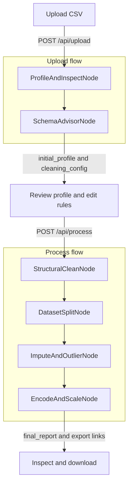

Design Doc: DataPrep Studio (React + FastAPI CSV Preprocessing Pipeline)Please DON'T remove notes for AIRequirementsNotes for AI: Keep it simple and clear.
If the requirements are abstract, write concrete user storiesΤο DataPrep Studio είναι μια full-stack διαδικτυακή εφαρμογή (React στο Frontend, FastAPI + Pandas/Scikit-Learn στο Backend) που επιτρέπει στον χρήστη να ανεβάζει ακατέργαστα αρχεία CSV (π.χ. titanic.csv), να επιθεωρεί την ποιότητα των δεδομένων και να εκτελεί αυτοματοποιημένα ή διαδραστικά τα 10 βήματα προεπεξεργασίας χωρίς Data Leakage.Concrete User StoriesΑνέβασμα & Αρχική Αυτοψία (Upload & Initial Inspection)Ως χρήστης, θέλω να ανεβάζω ένα αρχείο CSV μέσω drag-and-drop στο React UI, ώστε να βλέπω αμέσως τις διαστάσεις (shape), τυχαίο δείγμα γραμμών (sample), τύπους δεδομένων (dtypes), ποσοστά κενών τιμών (isna) και βασικά περιγραφικά στατιστικά (describe για αριθμητικές και κατηγορικές στήλες).Έξυπνη Πρόταση & Παραμετροποίηση Κανόνων (AI/Heuristic Rule Configuration)Ως χρήστης, θέλω το σύστημα να μου προτείνει αυτόματα τι να κάνω σε κάθε στήλη (π.χ. διαγραφή των id και cabin, εξαγωγή title από το name, γέμισμα age με grouped median, log-transform στο fare) και να μπορώ να εγκρίνω ή να αλλάξω αυτούς τους κανόνες από το React UI πριν τρέξει το pipeline.Ασφαλής Εκτέλεση χωρίς Data Leakage (Leakage-Free Pipeline Execution)Ως χρήστης, θέλω να επιλέγω τη στήλη-στόχο (π.χ. survived) ώστε το backend να χωρίζει πρώτα το dataset σε Train και Test set και μετά να υπολογίζει στατιστικά μεγέθη (διάμεσο, επικρατούσα τιμή, όρια IQR, StandardScaler) αποκλειστικά πάνω στο Train set.Σύγκριση Πριν/Μετά & Εξαγωγή (Before/After Preview & Export)Ως χρήστης, θέλω να βλέπω στο React UI μια σύγκριση του dataset πριν και μετά τον καθαρισμό (0 NaN, όλες οι στήλες αριθμητικές int/float), να κατεβάζω τα έτοιμα αρχεία (train_clean.csv, test_clean.csv) και να παίρνω έτοιμο τον κώδικα Python/Pandas που εκτελέστηκε.System Architecture Overview (React <-> FastAPI)Frontend (React + Tailwind CSS):FileUploadZone: Ανέβασμα CSV (POST /api/upload).DataInspectorDashboard: Πίνακες/κάρτες για .info(), .describe(), κατανομές και NaN counts.PipelineConfigBuilder: Φόρμα επιλογής βημάτων (renaming, drops, feature engineering, split ratio, imputation, encoding, scaling).ResultsAndExportView: Προεπισκόπηση τελικών δεδομένων και κουμπιά λήψης CSV / Python script (POST /api/process, GET /api/export/{session_id}).Backend (FastAPI + Pandas):Διαχειρίζεται τη ροή επεξεργασίας μέσω ενός Node-based Workflow πάνω σε ένα Shared Store ανά session_id.

## Flow Design

> Notes for AI:
> Consider the design patterns of agent, map-reduce, rag, and workflow. Apply them if they fit.
> Present a concise, high-level description of the workflow.
> This is two flows on one shared dict. The user reviews cleaning_config between them.

### Applicable Design Pattern

1. Sequential workflow, in two flows.
   Structural changes run on the whole frame. Imputation, outlier bounds, and scaling are fit on `train_df` only, then applied to `train_df` and `test_df`.
2. Agentic schema advisor, inside the upload flow.
   - *Context*: the column profile (dtype, null percent, unique count, skew, a few sample values). The raw rows stay out of the prompt.
   - *Action*: write `cleaning_config`. The user can edit that dict before the process flow starts.
3. Map-reduce, RAG, and parallel do not fit. Each step needs the previous frame, and each session is one CSV.

### Flow high-level Design

FastAPI keeps one `shared` dict per `session_id`. The upload flow fills the profile and the suggested rules. The process flow reads the rules the user saved and runs the leakage-free pipeline.

**Upload flow** (`AsyncFlow`, started by `POST /api/upload`):

1. **ProfileAndInspectNode**: read `raw_file_path`, load the CSV into `working_df`, and write `initial_profile`.
2. **SchemaAdvisorNode**: read `initial_profile` and `advisor_mode`, then write `cleaning_config`. Heuristic rules, or an LLM call when `advisor_mode` is `llm`.

The upload request ends here. FastAPI returns `initial_profile` and `cleaning_config`. The React screen is the pause: the user confirms the target column, the split, and the per-column rules.

**Process flow** (`Flow`, started by `POST /api/process`):

FastAPI writes the edited `cleaning_config` into the same dict, then starts at StructuralCleanNode.

3. **StructuralCleanNode**: rename, drop, clean strings, cast, and add engineered columns on `working_df`.
4. **DatasetSplitNode**: split into `train_df` and `test_df` before any statistic is fit. `test_size: null` keeps one frame and sets `test_df` to `None`. Then clear `working_df`.
5. **ImputeAndOutlierNode**: fit fill values and outlier bounds on `train_df`, apply them to both frames, and store them in `fitted_stats`.
6. **EncodeAndScaleNode**: encode and scale, check that the train frame has 0 nulls and only numeric columns, write the files, and store `final_report`.

Utility FunctionsNotes for AI:Understand the utility function definition thoroughly by reviewing the doc.Include only the necessary utility functions, based on nodes in the flow.Profile DataFrame (utils/pandas_profiler.py)Input: df (pd.DataFrame)Output: profile_dict (dict με shape, dtypes, missing_counts, missing_pct, duplicates_count, numeric_stats, categorical_stats, sample_rows)Χρησιμοποιείται από το ProfileAndInspectNode και το EncodeAndScaleNode (για την τελική επαλήθευση).Heuristic Cleaning Config (`utils/schema_advisor.py`)
- *Input*: profile dict από το `profile_dataframe`, προαιρετικά `target_column`
- *Output*: `cleaning_config` (dict)
- Κανόνες χωρίς δίκτυο: drop για id και στήλες με ≥70% κενά, mode / median / grouped median, binary ή one-hot, feature engineering όταν υπάρχουν `name`, `sibsp` και `parch`. Το `build_advisor_prompt(profile)` ετοιμάζει το prompt που το SchemaAdvisorNode στέλνει στο `call_llm` όταν ο χρήστης θέλει πρόταση από μοντέλο.

Call LLM (utils/call_llm.py)Input: prompt (str), response_schema (dict, optional)Output: response (dict ή str)Χρησιμοποιείται από το SchemaAdvisorNode για να προτείνει έξυπνους κανόνες καθαρισμού και Feature Engineering με βάση το profile_dict του CSV.Structural Transformations (utils/structural_ops.py)Input: df (pd.DataFrame), config (dict)Output: transformed_df (pd.DataFrame)Περιλαμβάνει συναρτήσεις για μετατροπή στηλών σε snake_case, μετονομασίες (rename), drop_duplicates(), διαγραφή στηλών, str.strip(), pd.to_numeric(errors='coerce') και εξαγωγή χαρακτηριστικών (π.χ. regex για title, άθροισμα για family_size). Χρησιμοποιείται από το StructuralCleanNode.Stateful Statistical Imputer & Outlier Handler (utils/stat_transformers.py)Input: train_df (pd.DataFrame), test_df (pd.DataFrame | None), config (dict)Output: (train_df, test_df, fitted_params) (tuple)Υπολογίζει (fit) τα στατιστικά μεγέθη (mode, median, grouped median dictionary, Q1/Q3 IQR bounds) αποκλειστικά στο train_df και τα εφαρμόζει (transform) και στα δύο DataFrames. Χρησιμοποιείται από το ImputeAndOutlierNode.Categorical Encoder & Feature Scaler (utils/encode_scale_ops.py)Input: train_df (pd.DataFrame), test_df (pd.DataFrame | None), config (dict)Output: (train_df, test_df, fitted_scaler_info) (tuple)Εφαρμόζει binary mapping (0/1), pd.get_dummies(drop_first=True) (χρησιμοποιώντας .reindex(columns=train_df.columns, fill_value=0) στο test_df ώστε να έχουν ακριβώς τις ίδιες στήλες) και StandardScaler. Χρησιμοποιείται από το EncodeAndScaleNode.Artifact & Script Exporter (utils/artifact_exporter.py)Input: session_id (str), train_df (pd.DataFrame), test_df (pd.DataFrame), config (dict)Output: export_info (dict με train_csv_path, test_csv_path, generated_python_code)Αποθηκεύει τα τελικά CSV στον δίσκο και παράγει ένα καθαρό, εκτελέσιμο αρχείο .py με όλο τον κώδικα Pandas που αντιστοιχεί στις επιλογές του χρήστη.Node DesignShared StoreNotes for AI: Try to minimize data redundancyΓια να αποφευχθεί ο διπλασιασμός μεγάλων συνόλων δεδομένων στη μνήμη, το shared store κρατάει μόνο τα ενεργά DataFrames της τρέχουσας συνεδρίας (session_id) και ελαφριά λεξικά μεταδεδομένων/ρυθμίσεων.The shared store structure is organized as follows:shared = {
    "session_id": "uuid-1234-5678",
    "raw_file_path": "/tmp/uploads/uuid-1234-5678_raw.csv",
    # FastAPI sets this before the upload flow. Nodes never read the HTTP body.
    # "heuristic" calls suggest_cleaning_config. "llm" calls call_llm_async.
    "advisor_mode": "heuristic",
    
    # Αρχική αυτοψία (Βήμα 1). This is the dict returned by profile_dataframe.
    "initial_profile": {
        "shape": [891, 12],
        "duplicates_count": 0,
        "columns": {
            "PassengerId": {"dtype": "int64", "null_pct": 0.0, "unique": 891},
            "Age": {"dtype": "float64", "null_pct": 19.86, "skew": 0.38, "median": 28.0},
            "Cabin": {"dtype": "object", "null_pct": 77.10, "unique": 147}
        },
        "sample_rows": []
    },
    
    # Κανόνες Προεπεξεργασίας (από το SchemaAdvisorNode + αλλαγές χρήστη στο React UI)
    "cleaning_config": {
        "target_column": "survived",
        "test_size": 0.2,
        "random_state": 42,
        "rename_map": {
            "passengerid": "id",
            "sibsp": "siblings_spouses",
            "parch": "parents_children"
        },
        "drop_columns": ["id", "ticket", "cabin"],
        "type_casting": {"fare": "numeric"},
        "string_cleaning": {
            "sex": "lower_strip",
            "embarked": "upper_strip"
        },
        "feature_engineering": {
            "extract_title_from_name": True,
            "create_family_size": True,
            "create_is_alone": True
        },
        "imputation": {
            "embarked": {"strategy": "mode"},
            "fare": {"strategy": "median"},
            "age": {"strategy": "grouped_median", "group_by": ["pclass", "sex"]}
        },
        "outliers": {
            "fare": {"strategy": "log1p", "new_col": "fare_log"},
            "age": {"strategy": "iqr_clip", "factor": 1.5}
        },
        "encoding": {
            "binary_map": {"sex": {"male": 0, "female": 1}},
            "one_hot": ["embarked", "title"]
        },
        "scaling": {
            "method": "standard",
            "columns": ["age", "fare_log", "family_size"]
        }
    },
    
    # Ενεργά DataFrames κατά τη ροή (in-memory references)
    "working_df": None,   # pd.DataFrame (χρησιμοποιείται μέχρι το Split)
    "train_df": None,     # pd.DataFrame (μετά το Split)
    "test_df": None,      # pd.DataFrame (μετά το Split)
    
    # JSON-safe numbers fit on train_df only. No second copy of the frames.
    # ImputeAndOutlierNode writes imputation + outliers.
    # EncodeAndScaleNode adds scaler and output_columns without deleting those keys.
    "fitted_stats": {
        "imputation": {},
        "outliers": {},
        "scaler": {},
        "output_columns": []
    },
    
    # Τελική αναφορά & αρχεία εξαγωγής για το React UI
    "final_report": {
        "train_shape": None,
        "test_shape": None,
        "total_nulls_remaining": None,
        "all_numeric_verified": False,
        "preview_rows": [],
        "train_csv_url": "",
        "test_csv_url": "",
        "python_script": ""
    }
}

## How nodes access the store

> Notes for AI: prep reads shared. exec never sees shared. post writes shared.
> Params are not used. This is one session dict, not a BatchFlow.
> Two flows share the same dict, with a pause so the user can edit cleaning_config.

FastAPI owns the dict. It creates one `shared` per upload and keeps it in memory under `session_id`. Nodes never look up that map and never read the request body.

Access rule for every node:

1. `prep(shared)` copies out only the keys that node needs and returns them as `prep_res`.
2. `exec(prep_res)` calls a utility. It returns new data. It does not read or write `shared`.
3. `post(shared, prep_res, exec_res)` writes the keys listed below and returns `"default"`.

The live table exists in only one key at a time. `working_df` holds it until the split. After the split, `working_df` is set to `None` and the rows live in `train_df` and `test_df`. Profiles, rules, fitted numbers, and the final report are small dicts. HTTP responses return those dicts, not the DataFrames.

| Key | Who writes it | Who reads it |
|---|---|---|
| `session_id`, `raw_file_path`, `advisor_mode` | FastAPI, before the upload flow | Profile reads the path. Advisor reads the mode. Encode reads the id. |
| `initial_profile` | ProfileAndInspectNode | SchemaAdvisorNode, and the upload response |
| `cleaning_config` | SchemaAdvisorNode, then FastAPI replaces it with the user's edit before the process flow | Structural, Split, Impute, Encode |
| `working_df` | Profile, then Structural replaces it | Structural, Split. Split then sets it to `None`. |
| `train_df`, `test_df` | Split, then Impute, then Encode replace them | Impute, Encode |
| `fitted_stats` | Impute writes `imputation` and `outliers`. Encode adds `scaler` and `output_columns`. | Encode reads it so it can add the scaler without dropping the imputation record |
| `final_report` | EncodeAndScaleNode | The process response |

`test_size: null` means EDA only. Split stores the whole frame in `train_df` and sets `test_df` to `None`. Later nodes must accept `test_df is None`.

## Node Steps

> Notes for AI: Carefully decide whether to use Batch/Async Node/Flow.
> Upload flow is AsyncFlow because the advisor may call the LLM.
> Process flow is a regular Flow. No Batch and no Parallel: each step depends on the previous frame.

### ProfileAndInspectNode

- *Purpose*: Load the CSV and build the inspection profile for the React dashboard.
- *Type*: Regular
- *prep*: Read `raw_file_path`.
- *exec*: `pd.read_csv(path)`, then `profile_dataframe(df)`. Return `(df, profile)`.
- *post*: `shared["working_df"] = df`, `shared["initial_profile"] = profile`.

### SchemaAdvisorNode

- *Purpose*: Turn `initial_profile` into a `cleaning_config` the user can edit.
- *Type*: Async
- *prep*: Read `initial_profile` and `advisor_mode`. Do not pass `working_df` into the prompt.
- *exec*: If mode is `heuristic`, call `suggest_cleaning_config(profile)`. If mode is `llm`, call `call_llm_async(build_advisor_prompt(profile), CLEANING_CONFIG_SCHEMA)`.
- *post*: `shared["cleaning_config"] = config`. The upload request ends here. FastAPI returns `initial_profile` and `cleaning_config`.

### StructuralCleanNode

- *Purpose*: Snake_case names, drop rows and columns, clean strings, cast types, add `title`, `family_size`, and `is_alone`.
- *Type*: Regular. First node of the process flow.
- *prep*: Read `working_df` and `cleaning_config`.
- *exec*: `apply_structural_cleaning(working_df, cleaning_config)`. Return the new frame.
- *post*: `shared["working_df"] = cleaned_df`.

### DatasetSplitNode

- *Purpose*: Split before any median, mode, IQR bound, or scaler is computed.
- *Type*: Regular
- *prep*: Read `working_df` and, from `cleaning_config`, `target_column`, `test_size`, `random_state`.
- *exec*: If `test_size` is null, return `(working_df, None)`. Otherwise `train_test_split`, with `stratify` on the target when that column exists.
- *post*: Write `train_df` and `test_df`. Set `working_df` to `None`.

### ImputeAndOutlierNode

- *Purpose*: Fit fill values and outlier bounds on `train_df`, then apply them to both frames.
- *Type*: Regular
- *prep*: Read `train_df`, `test_df`, and `cleaning_config`.
- *exec*: `fit_apply_imputation_and_outliers(train_df, test_df, cleaning_config)`. Return `(train_df, test_df, fitted)`.
- *post*: Replace `train_df` and `test_df`. Set `fitted_stats` from `fitted`, keeping the `imputation` and `outliers` keys.

### EncodeAndScaleNode

- *Purpose*: Encode categories, scale numeric columns, check that the train frame has 0 nulls and only numeric columns, then write the CSV files and the pandas script.
- *Type*: Regular
- *prep*: Read `session_id`, `train_df`, `test_df`, `cleaning_config`, and `fitted_stats`.
- *exec*: `fit_apply_encoding_and_scaling`, then `profile_dataframe` on the encoded train frame. Raise if `total_nulls != 0` or `all_numeric` is false, so the node retry can run. Then `export_artifacts`.
- *post*: Replace `train_df` and `test_df`. Add `scaler` and `output_columns` onto the existing `fitted_stats`. Write `final_report` with shapes, null count, the numeric check, a short `preview_rows` list, download URLs, and `python_script`.